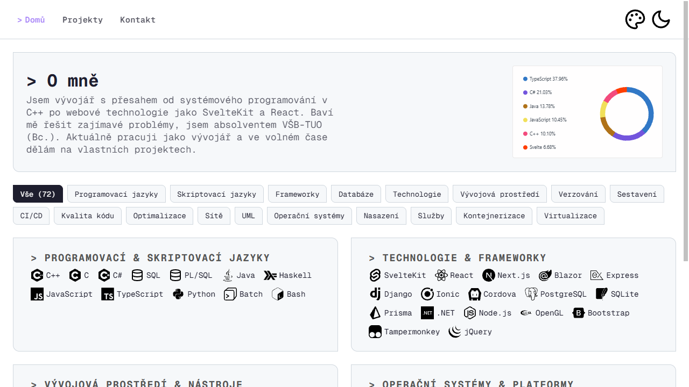
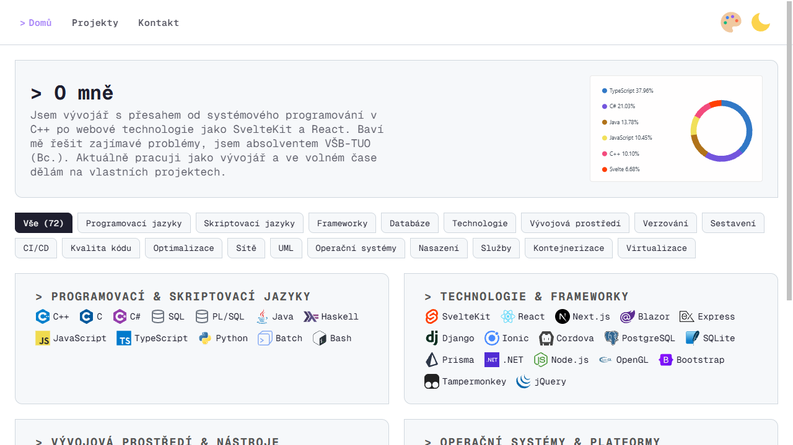
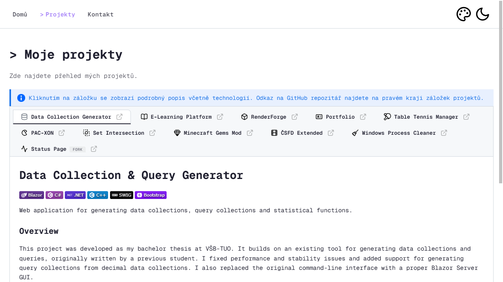
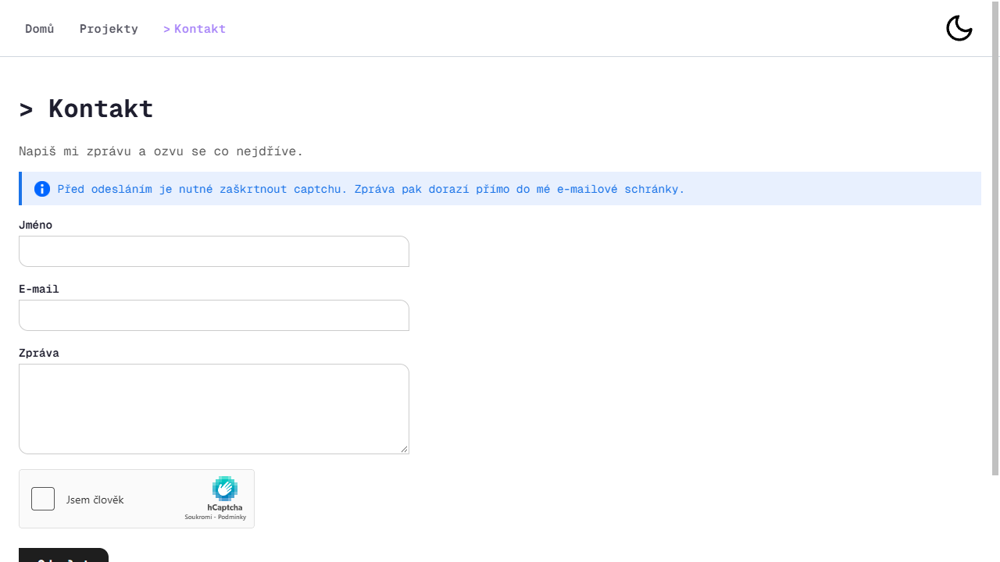

# Portfolio

![hCaptcha](https://img.shields.io/badge/hCaptcha-00B9BF?logo=)

Personal website and developer portfolio built with SvelteKit.

## Overview

I built this as my main developer portfolio, mainly to have a solid place to link from my CV and GitHub. Beyond just listing projects, I wanted the site itself to say something about how I write code, so I put extra care into details like the custom scrollbar behavior, the terminal-style heading hover effect and the asymmetric border radius used consistently across cards and inputs.

## Features

- Dark/light theme toggle
- Colorful skill logos toggle with hover preview
- Skill filtering by category
- Custom scrollbar with hover expansion
- Project browsing with Markdown rendering
- Scroll-to-top button with smooth animation
- Contact form integrated with Formspree
- Contact form secured by hCaptcha and honeypot
- Terminal-style headings with hover effect (`>` + blinking cursor)
- Smooth animations and loading spinner
- Fully responsive layout

## Tech stack

- **Framework:** SvelteKit
- **Language:** TypeScript
- **Libraries:** marked, marked-gfm-alert, overlayscrollbars
- **Forms:** Formspree, hCaptcha
- **Assets:** SVGO
- **Build:** Vite
- **Deploy:** Cloudflare Workers
- **SEO:** AWT

## Website

[Portfolio](https://portfolio.mk-forge.workers.dev/)

## Screenshots

## Credits

Icons are provided by [Lucide](https://lucide.dev/icons/) and [Tabler Icons](https://tabler.io/icons/), which are licensed under the ISC License and MIT License, respectively.

## License

[MIT](LICENSE)